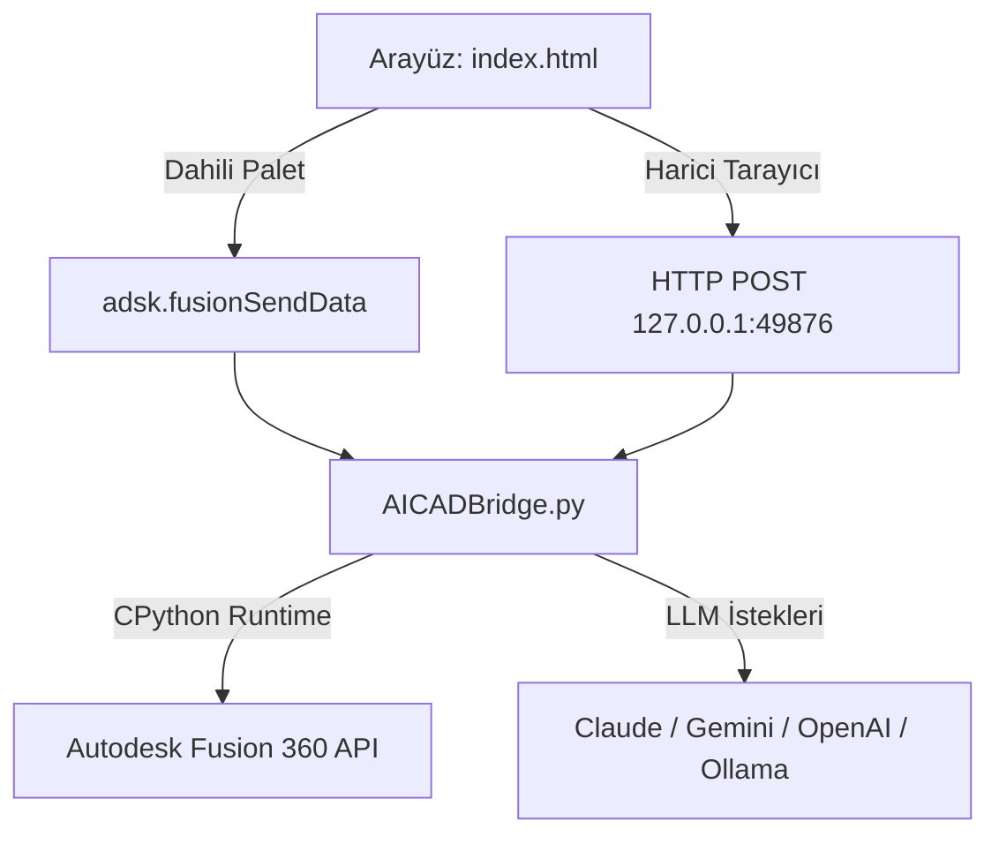

# 📐 AICADBridge — Proje Özeti ve Mimari

Bu doküman, **AICADBridge** projesinin çekirdek çalışma prensiplerini, dosya yapısını ve çalışma mantığını özetler.

---

## 🎯 Projenin Amacı

Kullanıcının doğal dilde verdiği 3D CAD modelleme komutlarını (örn: *"50mm çapında, 80mm yüksekliğinde, merkezinde 20mm delik bulunan bir silindir çiz"* veya *"Flanş modeline 4 adet eşit aralıklı M6 cıvata deliği aç"*):
1. Yapay zeka modelleri (Claude, GPT-4o, Gemini, DeepSeek veya yerel Ollama/LM Studio) aracılığıyla Autodesk Fusion 360 Python API koduna dönüştürmek,
2. Üretilen Python kodunu Fusion 360 CPython ortamında güvenle yürütmek,
3. Hata durumunda otomatik hata yakalama ve onarma (Self-Healing CAD) döngüsü çalıştırmak,
4. Kullanıcıya canlı parametre kontrolü (Parametric Sliders) sunmaktır.

---

## 🏗️ Çift Modlu Köprü Mimarisi (Dual-Bridge Architecture)

AICADBridge hem Fusion 360'ın dahili web paletinde hem de harici bir Chrome/Edge tarayıcısında sorunsuz çalışacak şekilde tasarlanmıştır:

### 1. Fusion 360 İçi Mod (Embedded Webview)
- Fusion 360 paletinde `adsk.core.HTMLEvent` ve `adsk.fusionSendData` kullanılır.
- Fusion 360 penceresi içinde native panel gibi hissettirir.

### 2. Harici Tarayıcı Modu (Web Bridge)
- Fusion eklentisi arka planda hafif bir Python HTTP sunucusu (`localhost:49876`) açar.
- Kullanıcı dilediği tarayıcıdan `index.html`'i açarak Fusion 360'ı uzaktan yönetebilir.

---

## 📁 Ana Dosya Yapısı

- `AICADBridge.py`: Eklentinin ana beyni. Fusion 360 komut döngüsü, olay dinleyicileri (event handlers), HTTP köprüsü, kod yürütücü (`executeCADCode`), model durumu okuyucu (`getDesignState`) ve LLM proxy mekanizmalarını barındırır.
- `index.html`: Uygulamanın modern karanlık temalı (Dark Neon) kullanıcı arayüzü. Chat arayüzü, parametrik panel, ayarlar modalı, model seçiciler ve köprü JavaScript mantığını içerir.
- `AICADBridge.manifest`: Autodesk Fusion 360 eklenti tanımlayıcısı.
- `config.py`: Port, varsayılan zaman aşımları ve genel eklenti yapılandırmaları.
- `Index.md`: Obsidian Ana Haritası.
- `CADAM_Tersine_Muhendislik_Mimarisi.md`: Tersine mühendislik mimari detayları.
- `Gelecek_Oturum_Yol_Haritasi.md`: Gelecek oturum hedefleri.
