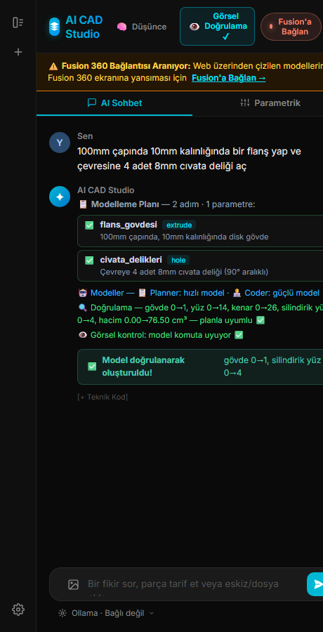
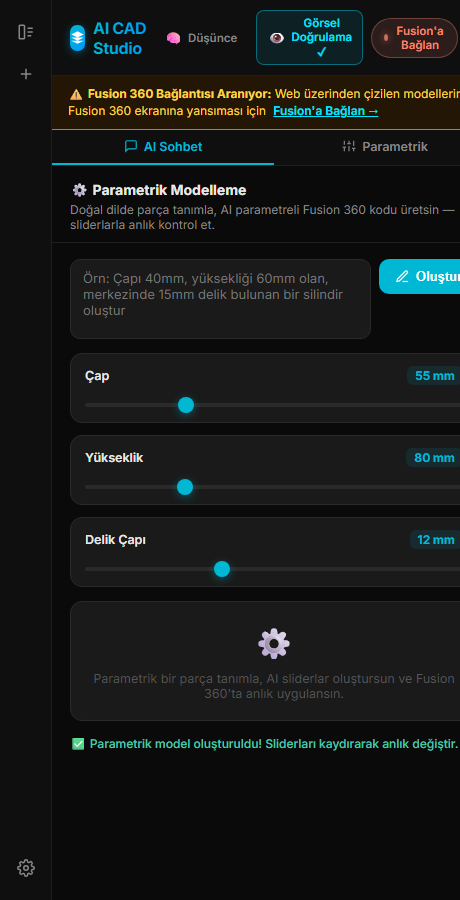

# 🤖 AICADBridge — SolidWorks (Adam-CAD / CADAM) & Autodesk Fusion 360 için Yapay Zeka Destekli 3D CAD Stüdyosu

<p align="center">
  <strong>Doğal dil komutlarıyla ve Adam-CAD canlı parametrik slider'larıyla SolidWorks ve Fusion 360'ta anında 3D katı modelleme yapın.</strong><br/>
  Design in 3D using natural language with SolidWorks COM API, Adam-CAD Parametric Sliders & Autodesk Fusion 360.
</p>

<p align="center">
  
  
  
  
  
  
</p>

---

## 📌 İçindekiler
1. [Projenin Amacı ve Özellikler](#-projenin-amacı--purpose)
2. [🛠️ SolidWorks + Adam-CAD (CADAM) Kurulumu ve Kullanımı (Adım Adım)](#️-solidworks--adam-cad-cadam-kurulumu-ve-kullanımı-adım-adım)
3. [🎛️ Adam-CAD Canlı Parametrik Modelleme Rehberi](#️-adam-cad-canlı-parametrik-modelleme-rehberi)
4. [📐 `sw` (`SolidWorksCADHelper`) Milimetre Tabanlı API Referansı](#-sw-solidworkscadhelper-milimetre-tabanlı-api-referansı)
5. [🏗️ Mimari ve Dosya Yapısı](#️-mimari--architecture)
6. [🚀 Fusion 360 Eklenti Kurulumu](#-fusion-360-kurulumu--installation)
7. [🎮 Doğal Dil Örnek Komutları](#-örnek-komutlar--example-commands)
8. [❓ Sorun Giderme (Troubleshooting)](#-sorun-giderme-troubleshooting)

---

## 🎯 Projenin Amacı / Purpose

**Türkçe:** Kullanıcının doğal dilde (Türkçe veya İngilizce) verdiği 3D CAD modelleme komutlarını yapay zeka modelleri aracılığıyla **SolidWorks (`SldWorks.Application` COM API)** veya **Autodesk Fusion 360 Python API** koduna dönüştürür, katı modeli ekranda anında oluşturur ve **Adam-CAD (CADAM)** mimarisiyle canlı slider'lar üzerinden ölçüleri gerçek zamanlı değiştirmenizi sağlar.

### ✨ Temel Özellikler / Key Features

- 🛠️ **Tam SolidWorks COM API Entegrasyonu**: SolidWorks içine ekstra eklenti kurmaya gerek kalmadan `win32com.client` üzerinden doğrudan açık olan SolidWorks oturumuna bağlanır; açık parça yoksa otomatik yeni `.SLDPRT` açar.
- 🌍 **Dil Bağımsız Düzlem Seçici (TR / EN)**: SolidWorks'ü Türkçe (*Üst Düzlem, Ön Düzlem, Sağ Düzlem*) veya İngilizce (*Top Plane, Front Plane, Right Plane*) kullansanız bile düzlemleri otomatik tanır.
- 🎛️ **Adam-CAD (CADAM) Canlı Parametrik Slider'lar**: Modelin çap, kalınlık, delik sayısı, genişlik gibi tüm parametrelerini kaydırma çubuklarıyla (slider) değiştirip SolidWorks ekranında anında yeniden oluşturur (`reset_part` + `EditRebuild3`).
- ⚡ **Hazır Mühendislik Şablonları (API Anahtarsız Test)**: *Mil Flanşı*, *L-Braket*, *Altıgen Göbekli Çark* ve *Elektronik Muhafaza Kutusu* şablonlarıyla LLM API anahtarı girmeden bile SolidWorks bağlantısını ve canlı slider'ları tek tıkla test edebilirsiniz.
- 🧠 **İki Aşamalı Üretim Hattı (Planner → Coder)**: Karmaşık parçaları önce JSON unsur planına (`extrude`, `cut`, `hole`, `fillet`, `chamfer`, `revolve`, `shell`, `pattern`) ayırır, ardından her adımı referans kod kütüphanesiyle (`snippets/solidworks/`) kodlayıp doğrular.
- 🔁 **Self-Healing CAD (Otomatik Hata Onarma)**: Üretilen kodda bir API veya geometri hatası oluşursa hatayı yakalar ve yapay zekaya otomatik düzelttirir.
- 🤖 **Çoklu AI & Yerel Model Desteği**: Groq (Llama 3.3), Google Gemini, Anthropic Claude, OpenAI, DeepSeek, OpenRouter ve yerel **Ollama / LM Studio**.

---

## 🛠️ SolidWorks + Adam-CAD (CADAM) Kurulumu ve Kullanımı (Adım Adım)

SolidWorks entegrasyonu Windows üzerinde COM API (`pywin32`) ile çalışır. SolidWorks içine herhangi bir DLL veya Add-In kopyalamanıza **gerek yoktur**.

### 1️⃣ Gereksinimleri Yükleyin

Bilgisayarınızda **SolidWorks** ve **Python 3.10+** kurulu olmalıdır. Terminal (PowerShell veya CMD) açıp `pywin32` kütüphanesinin kurulu olduğundan emin olun:

```powershell
git clone -b solidworks-adacad https://github.com/canmuratt-hub/AICADBridge.git
cd AICADBridge
py -m pip install pywin32 pillow
```

### 2️⃣ SolidWorks'ü Açın

- Bilgisayarınızda **SolidWorks** programını başlatın.
- İster boş bir **Parça (Part / `.SLDPRT`)** açın, ister ana ekranda bırakın (köprü ilk çizim komutunda otomatik olarak yeni bir Parça dokümanı açacaktır).

### 3️⃣ Köprü Sunucusunu Başlatın (Tek Tık)

Klasör içindeki **`baslat_solidworks.bat`** dosyasına çift tıklayın veya terminalden şu komutu çalıştırın:

```powershell
py solidworks_server.py
```

Sunucu başladığında:
1. `http://127.0.0.1:49876` portunda yerel köprü sunucusu açılır.
2. Varsayılan web tarayıcınızda otomatik olarak **`http://127.0.0.1:49876/app?cad=solidworks`** adresi açılır.
3. Üst bardaki durum rozetinde **🟢 SolidWorks Bağlı** ibaresi görünür.

> 💡 **CAD Hedefi Değiştirme:** Arayüzün sağ üst köşesindeki **🛠️ SolidWorks + Adam-CAD** butonuna tıklayarak istediğiniz an **SolidWorks** ve **Fusion 360** modları arasında canlı geçiş yapabilirsiniz.

### 4️⃣ Yapay Zeka (AI) Sağlayıcınızı Bağlayın

1. Sol menüden veya üst bardan **⚙️ Ayarlar** butonuna tıklayın.
2. Kullanmak istediğiniz sağlayıcıyı seçin:
   - **Groq / Gemini / OpenAI / Claude / DeepSeek:** API anahtarınızı yapıştırıp **Bağlan** butonuna basın, ardından **Modelleri Listele** ile modelinizi seçin.
   - **Ollama / LM Studio (Ücretsiz & Yerel):** Üstten **🖥️ Yerel Model** sekmesini seçin ve yerel modelinizi işaretleyin.

---

## 🎛️ Adam-CAD Canlı Parametrik Modelleme Rehberi

Arayüzün üst kısmındaki **🎛️ Parametrik** butonuna tıkladığınızda **Adam-CAD (CADAM)** paneli açılır. Bu modu iki şekilde kullanabilirsiniz:

### Yöntem A: Hazır Mühendislik Şablonları (Anında & API Anahtarsız)
Parametrik panelin altındaki hazır çiplerden birine tıklayın:
- **⚙️ Mil Flanşı**: Dış çap, göbek çapı, mil deliği çapı, flanş kalınlığı, PCD ve cıvata sayısı slider'larıyla 6 delikli flanş çizer.
- **📐 L-Braket**: Genişlik, taban uzunluğu, dikey kol yüksekliği, et kalınlığı ve montaj deliği çapı slider'larıyla L-braket çizer.
- **🔩 Altıgen Göbekli Çark**: Dış çap, gövde kalınlığı, çokgen göbek çapı, kenar sayısı, mil çapı ve hafifletme delikleriyle kasnak/çark çizer.
- **📦 Muhafaza Kutusu**: Genişlik (X), uzunluk (Y), yükseklik (Z) ve duvar kalınlığı slider'larıyla içi boşaltılmış kutu çizer.

Şablona tıkladığınız anda parça SolidWorks ekranında oluşur. **Slider'ları sağa-sola kaydırdığınızda** (400 ms debounce ile) SolidWorks modeli gerçek zamanlı olarak yeni ölçülerle yeniden çizilir!

### Yöntem B: Yapay Zeka ile Özel Parametrik Parça Üretimi
1. Parametrik kutuya istediğiniz parçayı yazın (ör. *"4 köşesinde M8 montaj deliği olan 120x80mm dikdörtgen motor bağlantı plakası, ortasında 40mm rulman yuvası"*).
2. **⚡ Parametrik Oluştur** butonuna basın.
3. Yapay zeka parçayı SolidWorks'te çizer ve o parçaya özel boyut slider'larını otomatik olarak ekrana dizerek size canlı kontrol verir.

---

## 📐 `sw` (`SolidWorksCADHelper`) Milimetre Tabanlı API Referansı

Normalde SolidWorks COM API'si tüm uzunlukları **metre (m)** cinsinden bekler ve `SelectByID2` çağrılarında dil/VARIANT uyumsuzlukları yaşanır. AICADBridge, çalışma alanına önceden enjekte edilen **`sw`** (`SolidWorksCADHelper`) nesnesi ile tüm işlemleri **milimetre (mm)** cinsinden ve dil bağımsız olarak yürütür:

| Metod (Tüm Ölçüler **mm**) | Açıklama |
| :--- | :--- |
| `sw.extrude_cylinder(diameter_mm, height_mm, x_mm=0, y_mm=0, plane='Top', merge=True)` | Belirtilen düzlemde daire çizip 3D silindir katılar (Boss-Extrude). |
| `sw.extrude_box(width_mm, length_mm, height_mm, x_mm=0, y_mm=0, plane='Top', centered=True, merge=True)` | Merkezden veya köşeden dikdörtgen çizip 3D prizma/plaka katılar. |
| `sw.extrude_polygon(sides, diameter_mm, height_mm, x_mm=0, y_mm=0, plane='Top', merge=True)` | Çokgen (örn. `sides=6` altıgen somun/göbek) profil çizip katılar. |
| `sw.cut_hole(diameter_mm, depth_mm=None, x_mm=0, y_mm=0, plane='Top', through_all=False)` | Mevcut katı gövde üzerinde dairesel delik açar (Extruded Cut). |
| `sw.cut_bolt_circle(hole_dia_mm, pcd_mm, count, depth_mm=None, plane='Top')` | Flanş vb. parçalar üzerinde dairesel dizilimli (`count` adet) cıvata delikleri açar. |
| `sw.cut_box(width_mm, length_mm, depth_mm=None, x_mm=0, y_mm=0, plane='Top')` | Dikdörtgen cep, kanal veya yuva kesmesi yapar. |
| `sw.fillet_edges(radius_mm)` | Aktif katı gövdenin kenarlarına radyus (Fillet) kırar. |
| `sw.chamfer_edges(distance_mm, angle_deg=45)` | Aktif katı gövdenin kenarlarına pah (Chamfer) kırar. |
| `sw.shell_body(wall_thickness_mm, remove_top_face=True)` | Gövdenin üst yüzünü açıp belirtilen et kalınlığıyla içini boşaltır (Shell). |
| `sw.revolve_profile(points_mm, angle_deg=360, plane='Front', merge=True)` | `[(r1, z1), (r2, z2), ...]` koordinatlarından kapalı profili eksen etrafında döndürerek katılar (Revolve). |
| `sw.reset_part()` | Parametrik slider güncellemesi öncesinde parça unsurlarını temizler. |
| `sw.rebuild()` | Modeli yeniden hesaplar (`EditRebuild3`) ve ekrana tam sığdırır (`ViewZoomtofit2`). |

---

## 🏗️ Mimari / Architecture

AICADBridge, Çoklu-CAD Adaptör Yönlendiricisi (`aicad_bridge/adapters/`) sayesinde hem **SolidWorks** hem de **Autodesk Fusion 360** ile aynı arayüz üzerinden çalışır:

```text
┌─────────────────────────────────────────────────────────────────────┐
│                          index.html (UI)                            │
│        Dark Neon Sohbet + Adam-CAD Canlı Parametrik Sliderlar       │
└───────────────┬─────────────────────────────────────┬───────────────┘
                │                                     │
     HTTP POST 127.0.0.1:49876              Dahili Palet / HTTP
      (cad_target='solidworks')            (cad_target='fusion360')
                │                                     │
┌───────────────▼───────────────┐     ┌───────────────▼───────────────┐
│     solidworks_server.py      │     │        AICADBridge.py         │
│  aicad_bridge/adapters/       │     │  aicad_bridge/adapters/       │
│        solidworks.py          │     │         fusion360.py          │
└───────────────┬───────────────┘     └───────────────┬───────────────┘
                │                                     │
     win32com (COM Bridge)                    adsk.core / adsk.fusion
      SldWorks.Application                      Fusion 360 API
```

### 📁 Dosya Yapısı / File Structure

```text
AICADBridge/
├── baslat_solidworks.bat           # Tek tıkla SolidWorks + Adam-CAD başlatıcı (Windows)
├── solidworks_server.py            # Bağımsız SolidWorks HTTP & COM köprü sunucusu
├── AICADBridge.py                  # Fusion 360 ana eklenti giriş noktası
├── index.html                      # Dark Neon UI (SolidWorks + Fusion 360 + Adam-CAD Sliders)
├── .env.example                    # Yapılandırma şablonu (AICAD_CAD_TARGET, model ayarları)
├── aicad_bridge/
│   ├── adapters/
│   │   ├── __init__.py             # Multi-CAD adaptör yönlendiricisi (solidworks | fusion360)
│   │   ├── solidworks.py           # SolidWorks COM API + SolidWorksCADHelper (sw)
│   │   └── fusion360.py            # Fusion 360 API adaptörü
│   ├── bridge/local_http.py        # Yerel HTTP sunucusu (/execute, /design_state, /update_params, /app)
│   ├── llm/
│   │   ├── pipeline.py             # İki aşamalı üretim hattı (Planner -> Coder -> Verify)
│   │   └── prompt.py               # SolidWorks ve Fusion 360 sistem promptları
│   ├── config.py                   # .env okuyucu ve ayar yöneticisi
│   ├── events.py                   # Ana iş parçacığı ve çoklu CAD olay yöneticisi
│   └── worker.py                   # Arka plan LLM ve Self-Healing işçisi
├── snippets/
│   ├── loader.py                   # Çoklu CAD snippet yükleyici
│   ├── index.json                  # Fusion 360 kod şablonları
│   └── solidworks/                 # SolidWorks (Adam-CAD) doğrulanmış kod şablonları (9 adet)
└── tests/
    ├── test_solidworks.py          # SolidWorks adaptörü, snippet ve preset birim testleri
    ├── test_pipeline.py            # Planner/Coder üretim hattı testleri
    ├── test_llm.py                 # LLM istemci testleri
    └── test_config.py              # Yapılandırma testleri
```

---

## 📸 Uygulamadan Görünümler / Screenshots

| İki Aşamalı Üretim Hattı (Planner → Coder) | Parametrik Sliderlar (Adam-CAD) |
|:---:|:---:|
|  |  |

---

## 🚀 Fusion 360 Kurulumu / Installation

Projeyi SolidWorks dışında **Autodesk Fusion 360** içinde de kullanmak isterseniz:

1. Klonlanan `AICADBridge` klasörünü Fusion 360 `AddIns` dizinine kopyalayın:
   - **Windows:** `%APPDATA%\Autodesk\Autodesk Fusion 360\API\AddIns\`
   - **macOS:** `~/Library/Application Support/Autodesk/Autodesk Fusion 360/API/AddIns/`
2. Fusion 360 içinde **Tools → Add-Ins → Scripts and Add-Ins** penceresinden **AICADBridge**'i seçip **Run** butonuna tıklayın.
3. Üst bardaki CAD hedef seçiciyi **Fusion 360** konumuna getirin.

---

## 🎮 Örnek Komutlar / Example Commands

Sohbet kutusuna veya Parametrik moda aşağıdaki gibi doğal dil komutları yazabilirsiniz:

```text
TR: "120mm dış çapında, 15mm kalınlığında, ortasında 35mm mil deliği ve 85mm çap dairesinde 6 adet 10mm cıvata deliği olan bir flanş çiz"
EN: "Create a flange with 120mm outer diameter, 15mm thickness, 35mm center bore and 6x 10mm bolt holes on an 85mm PCD"

TR: "100x60x40mm ölçülerinde, et kalınlığı 4mm olan içi boşaltılmış elektronik muhafaza kutusu çiz ve kenarlarına 2mm pah kır"
EN: "Create a 100x60x40mm hollowed enclosure box with 4mm wall thickness and 2mm chamfered edges"

TR: "Mevcut gövdenin üst yüzeyine 4 adet M8 montaj deliği aç"
EN: "Cut 4 M8 mounting holes on the top face of the current body"
```

---

## 🧪 Testleri Çalıştırma

Projede SolidWorks COM adaptörü, 9 SolidWorks snippet'i, 4 Adam-CAD parametrik şablonu, Planner/Coder üretim hattı ve yapılandırma modüllerini doğrulayan **55 adet birim testi** bulunur:

```powershell
py -m pytest -v
```

---

## ❓ Sorun Giderme (Troubleshooting)

1. **"SolidWorks Köprüsü Aranıyor / Bağlanılamadı" uyarısı alıyorum:**
   - Klasördeki `baslat_solidworks.bat` dosyasının (veya `py solidworks_server.py` komutunun) arka planda açık olduğundan emin olun.
   - SolidWorks'ün açık olduğunu kontrol edin.
2. **SolidWorks açık ama çizim yapılmıyor:**
   - SolidWorks içinde açık bir iletişim kutusu (ör. "Değişiklikleri kaydet?", özellik penceresi veya aktif bir komut) varsa ESC tuşuna basarak kapatın; açık modal pencereler COM API komutlarını bekletebilir.
3. **`win32com` hatası alıyorum:**
   - Terminalde `py -m pip install pywin32` komutunu çalıştırıp sunucuyu yeniden başlatın.

---

## 📄 Lisans / License

MIT License — Orijinal Proje: [Yunus Ayyıldız](https://github.com/yunusayyldz) | SolidWorks & Adam-CAD Entegrasyonu: `solidworks-adacad` branch.
